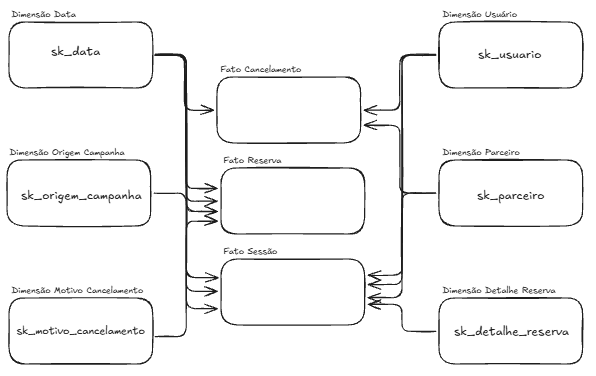

# Requisitos Técnicos — Área de Produto

> **Projeto:** Modelagem analítica da plataforma de reservas/locação de veículos (dbt + DuckDB)
> **Área entrevistada:** Produto
> **Responsável pela entrevista:** Murilo — Analytics Engineering
> **Objetivo:** Levantamento dos requisitos técnicos referentes a adoção e solução dos problemas de negócio conforme o Roteiro de Entrevista.

---

## 1. Requisitos técnicos derivados

### 1.1 Modelos dbt

| Camada | Modelo | Necessidade de Produto atendida |
|---|---|---|
| Staging | `stg_reservas`, `stg_cancelamentos`, `stg_sessoes`, `stg_buscas`, `stg_parceiro` | Padronização, tipagem e limpeza 1:1 com as fontes |
| Intermediate | `int_reservas_com_cancelamento` | Regra de reserva válida e cancelamento (RN01, RN02) |
| Intermediate | `int_sessoes_enriquecidas` | Sessões com buscas agregadas e flags (RN08) |
| Intermediate | `int_desempenho_parceiro` | Desempenho e comissão do parceiro (RN12) |
| Marts — dimensões | `dim_usuarios`, `dim_parceiros`, `dim_data` | Contexto de usuário, parceiro e tempo |
| Marts — dimensões junk | `dim_detalhe_reserva`, `dim_motivo_cancelamento`, `dim_origem_campanha` | Atributos descritivos de baixa cardinalidade |
| Marts — fatos | `fct_reservas`, `fct_cancelamentos`, `fct_sessoes` | Eventos mensuráveis: reserva, cancelamento e sessão |

### 1.2 Requisitos de qualidade e governança

- **Contrato de dados** ativo em todos os marts (`contract.enforced: true`), com `data_type` em todas as colunas.
- **Constraints** (`not_null`, `primary_key`, `check`) nas colunas críticas.
- **Testes**: `unique`, `not_null`, `relationships` (fato → dimensão), `accepted_values`, `dbt_utils.accepted_range` e `dbt_expectations`.
- **Modelo incremental** para `fct_reservas`, com `unique_key` e `on_schema_change: fail`.
- **Metadados**: `group`, `access: public`, `tags` e `meta` (dono, criticidade, SLA, consumidores, PII).
- **Dimensão de data** física (`dim_data`) para análises por qualquer granularidade de tempo.

### 1.3 Novas tabelas e métricas sugeridas (evolução)

Necessidades levantadas na entrevista que ainda **não** estão cobertas pelo modelo atual:

| Item | Descrição | Prioridade |
|---|---|---|
| `fct_funil_conversao` | Fato de funil (busca → clique → reserva) por sessão/usuário | Alta |
| `dim_veiculo_categoria` | Dimensão de categoria de veículo (hoje é atributo da junk) | Média |
| Ligação campanha → primeira reserva | Atribuição da origem de campanha à primeira reserva do usuário | Alta |
| Camada semântica | Definição centralizada das métricas da seção 5 | Alta |

### 1.4 Rastreabilidade: necessidade → requisito

| Necessidade de Produto | Requisito técnico |
|---|---|
| "Reserva válida sem divergência" | Regra única em `int_reservas_com_cancelamento` + testes em `fct_reservas` |
| "Entender por que cancelam" | `fct_cancelamentos` + `dim_motivo_cancelamento` |
| "Saber onde o usuário desiste" | `fct_sessoes` + evolução `fct_funil_conversao` |
| "Qual canal traz quem reserva" | `dim_origem_campanha` + atribuição campanha → reserva |
| "Analisar por qualquer período" | `dim_data` |
| "Confiar nos números" | Contratos, constraints e testes automatizados |
| "Autonomia sem depender de dados" | Marts documentados + camada semântica |

---

## 2 Modelagem Dimensional
